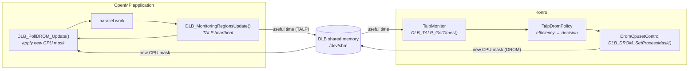
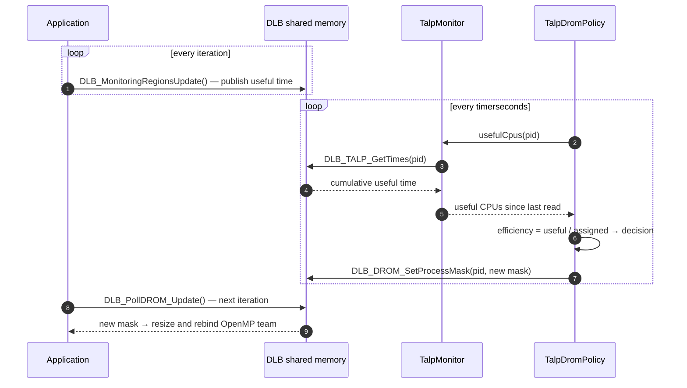
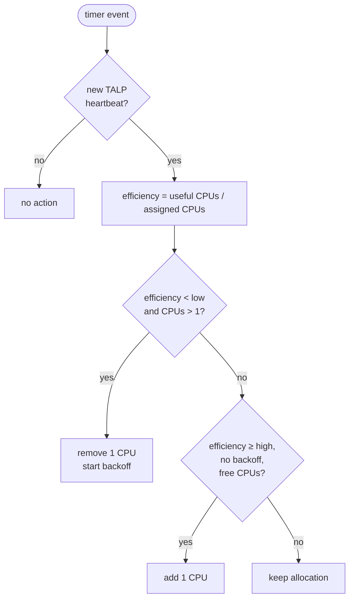

<div align="center">

# Performance-Aware CPU Allocation in Konro

### Integrating BSC's TALP heartbeat library into the Konro-DROM resource manager


</div>

> **Summary.** Konro could already resize the CPU set of HPC applications at
> run time through DROM, but its decisions were driven by a feedback value that
> the application had to compute and send by itself — in the demonstrator, a
> random number. This work connects Konro to **TALP**, the performance
> monitoring module of BSC's DLB library: applications now emit a lightweight
> *heartbeat*, Konro measures how many of their CPUs do useful work, and a new
> policy, **`TalpDromPolicy`**, moves CPUs from applications that waste them to
> applications that can use them. With two concurrent workloads on 8 CPUs, the
> TALP-driven policy reduces the makespan by **39%** while reserving **35%**
> fewer CPU-seconds than the feedback-driven baseline.

---

## Contents

1. [Background](#1-background)
2. [Design](#2-design)
3. [Allocation policy](#3-allocation-policy)
4. [Integrating an application](#4-integrating-an-application)
5. [Building and reproducing the results](#5-building-and-reproducing-the-results)
6. [Experimental evaluation](#6-experimental-evaluation)
7. [Issues found in DLB 3.8 and workarounds](#7-issues-found-in-dlb-38-and-workarounds)
8. [Other changes to Konro](#8-other-changes-to-konro)
9. [Limitations and future work](#9-limitations-and-future-work)
10. [Repository layout](#10-repository-layout)

---

## 1. Background

| Component | Role in this work |
|---|---|
| **Konro** | Event-driven resource manager. It tracks the applications it manages and delegates allocation decisions to a pluggable *policy*. |
| **DLB** | *Dynamic Load Balancing* library developed at the Barcelona Supercomputing Center. It coordinates processes on a node through a shared-memory segment. |
| **DROM** | DLB module that lets an administrator process (Konro) change the CPU mask of a running application (`DLB_DROM_SetProcessMask`). The application applies it at its next poll (`DLB_PollDROM_Update`). |
| **TALP** | DLB module that measures, per process, the time spent in *useful* computation versus parallel-runtime overhead (OpenMP via OMPT, MPI via PMPI). With `--talp-external-profiler` it publishes the metrics in the shared memory, where a third-party process can read them (`DLB_TALP_GetTimes`). |

**Starting point.** The existing `DromRandPolicy` added or removed one CPU
whenever an application sent a feedback value over HTTP (`< 70`: more CPUs,
`> 130`: fewer). The value had no link to the actual use of the CPUs: in the
`backprop` demonstrator it was drawn at random.

**Goal.** Base the allocation on a quantity that Konro measures itself: the
number of CPUs each application keeps busy with useful work.

---

## 2. Design

### 2.1 Architecture



The application and Konro never talk to each other directly: both sides use
the DLB shared memory, TALP in one direction and DROM in the other. The HTTP
channel is still used to register the application (`runner` → `/add`) but no
longer carries feedback.

### 2.2 Components

| Component | Location | Responsibility |
|---|---|---|
| `TalpMonitor` | `konro_loc/rm/platformcontrol/drom/talpmonitor.{h,cpp}` | Attaches to DLB as a TALP third-party reader (`DLB_TALP_Attach`). For each process it keeps the last cumulative useful time read and returns the CPUs used since then, or *no data* if no heartbeat arrived in between. Singleton, like `DromCpusetControl`. |
| `TalpDromPolicy` | `konro_loc/rm/policymanager/policies/talpdrompolicy.{h,cpp}` | Allocation policy (Section 3). Derives from `DromRandPolicy` and reuses its application registration, initial CPU assignment and SLURM socket; overrides `timer()`, `removeApp()` and `feedback()`. |
| `drom_omp_binding.h` | `konro_loc/konrolib/drom_omp_binding.h` | Header-only helper for applications (C and C++). Registers the DLB callback that applies a DROM mask to the OpenMP team: thread count and thread-to-CPU binding (Section 7). |
| Heartbeat | `konro_backprop_loc/src/facetrain.cpp` | `DLB_MonitoringRegionsUpdate()` at the end of every training iteration of the demonstrator. |

### 2.3 Measured quantity

TALP provides, for each process $p$, the cumulative useful time
$U_p(t)$ summed over all its threads. At every timer event Konro reads it and
computes, over the elapsed interval $\Delta t$:

$$
\text{useful CPUs}_p = \frac{U_p(t) - U_p(t - \Delta t)}{\Delta t}
\qquad\qquad
\text{efficiency}_p = \frac{\text{useful CPUs}_p}{\text{CPUs assigned to } p}
$$

An efficiency close to 1 means that every assigned CPU is doing useful work; a
low efficiency means that CPUs are idle or spent in runtime overhead.

### 2.4 Control loop



---

## 3. Allocation policy

At every timer event `TalpDromPolicy` evaluates each managed application:



**Backoff.** After removing a CPU, the application cannot grow for
`backoffperiods` timer events. Without it, an application that cannot exploit
a second CPU would oscillate indefinitely (1 → 2 → 1 → 2 …); with it, the
policy still re-probes periodically in case the application's behaviour changes.

**Choice of thresholds.** For an application with serial fraction $s$ running
on $n$ CPUs, Amdahl's law gives an efficiency of $\dfrac{1}{n\,(s + (1-s)/n)}$.
With the default thresholds:

| Application | Behaviour |
|---|---|
| purely sequential | efficiency 0.5 on 2 CPUs → falls below 0.6 → back to 1 CPU |
| 10% serial | efficiency 0.83 on 3 CPUs, 0.77 on 4 → stops growing at 3 CPUs |
| 50% serial | efficiency 0.67 on 2 CPUs (between the thresholds) → stays at 2 CPUs |

**Configuration.** All parameters are optional and read from the `[talp]`
section of the Konro configuration file:

```ini
[policy]
policy = TalpDromPolicy

[talp]
lowefficiency  = 0.6   ; below: remove one CPU
highefficiency = 0.8   ; at or above: add one CPU
backoffperiods = 5     ; timer events without growth after a removal
```

Feedback messages are accepted and recorded but do not influence the decision.

---

## 4. Integrating an application

An OpenMP application needs three calls and one environment setting.

```c
#include "drom_omp_binding.h"

int main(void) {
    #pragma omp parallel        /* start the OpenMP runtime (and DLB via OMPT) */
    { }
    konro_drom_omp_init();      /* DROM masks will resize and bind the team    */

    for (;;) {
        DLB_PollDROM_Update();          /* apply the CPU mask chosen by Konro */
        /* ... one iteration of parallel work ... */
        DLB_MonitoringRegionsUpdate();  /* TALP heartbeat                     */
    }
}
```

```bash
export OMP_TOOL_LIBRARIES=/usr/local/lib/libdlb.so
export DLB_ARGS="--drom --ompt --ompt-thread-manager=none --talp=openmp --talp-external-profiler"
./runner ./my_app <args>        # registers the application with Konro
```

| DLB option | Purpose |
|---|---|
| `--drom` | let Konro change the CPU mask of the process |
| `--ompt` | let DLB observe the OpenMP runtime through OMPT |
| `--ompt-thread-manager=none` | disable DLB's thread manager (see Section 7, issue 1) |
| `--talp=openmp` | measure useful time in OpenMP applications |
| `--talp-external-profiler` | publish TALP metrics in the shared memory for Konro |

---

## 5. Building and reproducing the results

A container image provides the complete toolchain: Ubuntu 24.04, clang 18, LLVM
`libomp` and DLB 3.8.0 built from source. It runs on x86_64 and arm64 and was
tested on Apple Silicon. On a native Ubuntu 24.04 machine, the same dependencies
can be installed with `sudo bash docker/install-deps.sh`.

```bash
# environment
docker build -t konro-talp -f docker/Dockerfile .
docker run --rm -it --name konro-talp --shm-size=256m --privileged \
           -v "$PWD":/workspace konro-talp

# inside the container: Konro, demonstrator, tools
cmake -S konro_loc -B konro_loc/build -DCMAKE_BUILD_TYPE=Release
cmake --build konro_loc/build -j
cmake -S konro_backprop_loc -B konro_backprop_loc/build -DCMAKE_BUILD_TYPE=Release \
      -DPATH_TO_KONROLIB=$PWD/konro_loc/build/konrolib/libkonrolib.a \
      -DCMAKE_INSTALL_PREFIX=$PWD/konro_backprop_loc/build/dist
cmake --build konro_backprop_loc/build --target install -j
mkdir -p tools/build
clang -O2 -fopenmp -o tools/build/talp_testapp tools/talp_testapp.c -ldlb
clang -O2          -o tools/build/talp_sampler tools/talp_sampler.c -ldlb
clang -O2          -o tools/build/talp_probe   tools/talp_probe.c   -ldlb

# full evaluation: 3 scenarios x 2 policies x 5 repetitions (~40 min)
experiments/run_all.sh 5
python3 experiments/aggregate.py
```

`--privileged` is required because Konro moves every managed application into
its own cgroup under `/sys/fs/cgroup`.

| Script | Description |
|---|---|
| `experiments/run_experiment.sh` | Runs one experiment: starts Konro with a given configuration and the sampler, launches the applications through `runner`, collects logs, samples and run times. |
| `experiments/run_all.sh` | Runs the whole evaluation with N repetitions. |
| `experiments/plot.py` | Per-run timeline of assigned and useful CPUs. |
| `experiments/aggregate.py` | Mean ± standard deviation over repetitions and comparison chart. |
| `tools/talp_sampler` | Policy-independent recorder of assigned CPUs (kernel affinity) and useful CPUs (TALP). |
| `tools/talp_probe` | Minimal TALP third-party reader, for diagnostics. |
| `tools/talp_testapp` | Synthetic OpenMP application with a configurable serial fraction. |

---

## 6. Experimental evaluation

### 6.1 Setup

| | |
|---|---|
| **Hardware** | Apple M4 Pro, Docker Desktop Linux VM (arm64) with 8 CPUs |
| **Software** | Ubuntu 24.04, clang 18, LLVM libomp, DLB 3.8.0 |
| **Konro** | policy timer 2 s |
| **Repetitions** | 5 per configuration; results reported as mean ± 1 standard deviation |
| **Measurements** | `talp_sampler`, every 2 s, independent of the policy under test |

**Workloads**

| Scenario | Applications | Characteristics |
|---|---|---|
| `backprop` | `backprop 2000000 80` | the existing demonstrator; limited parallelism (≈ 1.3 useful CPUs at most) |
| `scal` | `talp_testapp 60 800 0.1` | fixed work per iteration, 10% serial: scales according to Amdahl's law |
| `mix` | both, started 1 s apart | competition for the same CPUs |

**Policies compared.** The baseline is `DromRandPolicy` driven by the random
feedback of `backprop`. `talp_testapp` sends no feedback, so under the baseline
it keeps its initial CPU, which is equivalent to a static allocation.

**Metrics.** *Makespan*: time until all applications of the scenario have
finished. *Reserved CPU-seconds*: integral over time of the CPUs assigned to
the applications. *Efficiency*: useful CPU time divided by assigned CPU time.

### 6.2 Results

<p align="center">
  
</p>

| Scenario | Policy | Makespan [s] | Reserved CPU·s | Efficiency |
|---|---|---:|---:|---:|
| `backprop` | random feedback | 25.6 ± 0.7 | 88 ± 30 | 0.41 ± 0.08 |
| | **TALP** | 27.0 ± 0.5 | **35 ± 2** | **0.80 ± 0.03** |
| `scal` | static (1 CPU) | 48.2 ± 0.0 | 48 ± 0 | 0.99 ± 0.00 |
| | **TALP** | **25.0 ± 0.2** | 55 ± 1 | 0.83 ± 0.00 |
| `mix` | random feedback | 48.2 ± 0.0 | 149 ± 13 | 0.39 / 1.01 ¹ |
| | **TALP** | **29.4 ± 0.5** | **97 ± 2** | 0.82 / 0.78 ¹ |

<sub>¹ backprop / talp_testapp.</sub>

### 6.3 Discussion

- **`backprop`, an application with limited parallelism.** The random policy
  often grants it 3–6 CPUs that it cannot use, so its efficiency is 0.41. The
  TALP policy keeps it at 1–2 CPUs: **60% fewer CPU-seconds** for a **5%**
  longer run time, with efficiency doubled.
- **`scal`, a scalable application.** The TALP policy grows it from 1 to 3 CPUs
  and stops where the measured efficiency reaches the 0.8 threshold, as
  predicted by Amdahl's law: **1.9× faster** with 15% more CPU-seconds.
- **`mix`, applications competing for CPUs.** CPUs move from the application
  that wastes them to the one that can exploit them. Both finish earlier
  overall: **makespan −39%** and **35% fewer CPU-seconds**.
- **Predictability.** The TALP policy is also far more stable: the standard
  deviation of reserved CPU-seconds drops from 30 to 2 in `backprop` and from 13
  to 2 in `mix`, because decisions depend on measurements rather than on random
  values.

---

## 7. Issues found in DLB 3.8 and workarounds

Running TALP and DROM together on OpenMP applications exposed the following
problems. Each one was reproduced, traced in the DLB and LLVM OpenMP sources,
and worked around without modifying DLB.

| # | Symptom | Cause | Workaround |
|---|---|---|---|
| 1 | Heap corruption (`realloc(): invalid next size`) when Konro grows an application | In the OMPT *parallel-begin* callback, TALP sizes its per-thread array with the announced team size; immediately after, DLB's `omp5` thread manager polls DROM and calls `omp_set_num_threads()` with a larger value. libomp resizes the team **after** the callback, so the extra threads write past the TALP array. | `--ompt-thread-manager=none`, plus `drom_omp_binding.h`, which resizes the team in `DLB_PollDROM_Update()`, outside any parallel region. |
| 2 | With the thread manager disabled, DROM masks are received but never applied | No component registers the `dlb_callback_set_process_mask` callback, so `DLB_PollDROM_Update()` succeeds without effect. | `drom_omp_binding.h` registers it: sets the number of threads and binds each thread to a CPU of the mask. |
| 3 | `DLB_PollDROM_Update()` returns `DLB_ERR_NOINIT` although DLB was initialised through OMPT | The OMPT-driven initialisation is not always visible from the main thread. | `konro_drom_omp_init()` calls `DLB_Init()` explicitly (ignoring `DLB_ERR_INIT`) and finalises DLB at exit. |
| 4 | Ubuntu's `libomp.so.5` does not load DLB as OMPT tool | `ompt_start_tool` is resolved inside libomp itself instead of in `libdlb.so`. | `OMP_TOOL_LIBRARIES=/usr/local/lib/libdlb.so`. |
| 5 | A restarted application fails to register in DLB | Stale entries in the shared memory after an application is killed. | `dlb_shm -d` before each run (done by `run_experiment.sh`). |

---

## 8. Other changes to Konro

| Change | Files | Reason |
|---|---|---|
| Missing `#include <cassert>` | `cputracker.h`, `puprogressivepolicy.cpp` | Build failure with recent compilers. |
| Proc Connector enum access | `proclistener.cpp` | The enum is no longer nested in `struct proc_event` since Linux 6.6; both header versions are now supported. |
| `/proc` polling fallback | `proclistener.{h,cpp}` | Kernels without the Proc Connector (e.g. the Docker Desktop VM) made Konro stop at start-up; it now detects process termination by polling `/proc`. |
| `protected` members | `dromrandpolicy.h` | Allow `TalpDromPolicy` to reuse the DROM CPU control. |

*Note on the existing code:* in `PolicyManager::makePolicy` the `NoPolicy`
case falls through to `DromRandPolicy`, so a configuration without a policy
silently selects the DROM policy.

---

## 9. Limitations and future work

- **Measurement quantisation.** Konro measures useful CPUs between its own
  reads. When an iteration lasts a sizeable fraction of the timer period, the
  number of heartbeats per window varies (e.g. 0.8 / 1.2 useful CPUs for a
  constant load). A longer `timerseconds`, or a TALP timestamp of the last
  update, would remove this noise.
- **Step size.** One CPU is added or removed per period. A proportional step,
  towards `useful CPUs / target efficiency`, would converge faster on large nodes.
- **MPI.** Only OpenMP applications were evaluated; `TalpMonitor` already reads
  `mpi_time`, so MPI applications can be supported by the same mechanism.
- **Platforms.** Evaluation on a RISC-V board (e.g. BananaPI), as foreseen for
  the two-student version of the project.

---

## 10. Repository layout

```text
docker/                 container image and dependency installer
docs/                   this document and figures
experiments/            Konro configurations, experiment scripts, analysis
konro_loc/
  konrolib/drom_omp_binding.h            application-side DROM → OpenMP binding
  rm/platformcontrol/drom/talpmonitor.*  TALP reader
  rm/policymanager/policies/talpdrompolicy.*
konro_backprop_loc/     demonstrator (heartbeat added)
tools/                  talp_probe, talp_sampler, talp_testapp
```

**References.** DLB documentation: <https://pm.bsc.es/dlb> ·
DLB source: <https://github.com/bsc-pm/dlb> ·
Konro-DROM: <https://github.com/HEAPLab/konro-DROM-EUPilot>
