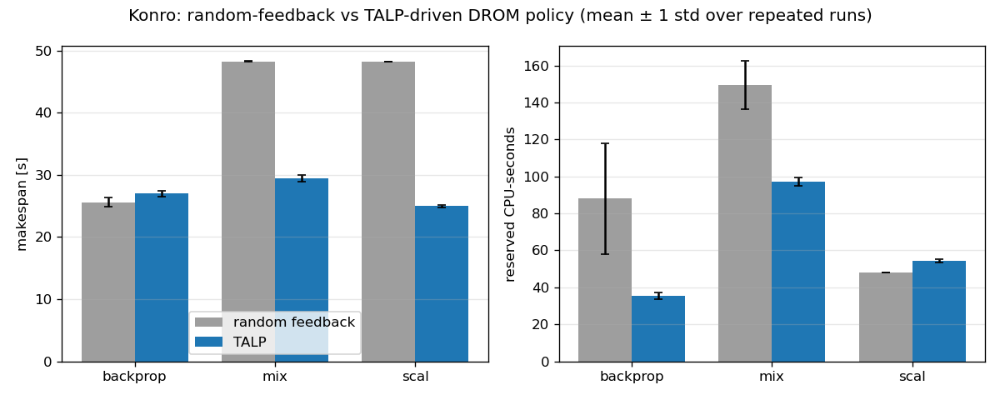

# Performance-Aware CPU Allocation with TALP

This document describes how Konro uses **TALP** (Tracking Application Live Performance, part of BSC's [DLB](https://pm.bsc.es/dlb) library) as a heartbeat library to allocate CPUs through DROM according to the measured performance ofeach application.

---

## Overview

Konro already resized the CPU set of running applications through DROM, but the `DromRandPolicy` based its decisions on a feedback value sent by the
application over HTTP (`< 70`: more CPUs, `> 130`: fewer CPUs). In the `backprop` demonstrator this value was random, so the allocation was unrelated
to how the application actually used its CPUs.

With this integration:

- the application publishes its TALP metrics at the end of every iteration (**heartbeat**);
- Konro reads them from the DLB shared memory and computes how many of the assigned CPUs are doing useful work;
- the new **`TalpDromPolicy`** adds or removes CPUs according to the resulting parallel efficiency. No feedback message from the application is needed;
- the demonstrator still sends its random feedback, so that the original `DromRandPolicy` can be used as a baseline; `TalpDromPolicy` ignores it.

---

## How it works

### Components

| Component | Location | Description |
|---|---|---|
| `TalpMonitor` | `konro_loc/rm/platformcontrol/drom/talpmonitor.{h,cpp}` | Attaches to DLB as a TALP third-party reader (`DLB_TALP_Attach`) and returns, for each process, the number of CPUs that did useful work since the previous read (`DLB_TALP_GetTimes`). Returns no value if no heartbeat was received in the meantime. |
| `TalpDromPolicy` | `konro_loc/rm/policymanager/policies/talpdrompolicy.{h,cpp}` | Allocation policy. Extends `DromRandPolicy`, reusing application registration, initial CPU assignment and the SLURM socket; decisions are taken in `timer()`. |
| `drom_omp_binding.h` | `konro_loc/konrolib/drom_omp_binding.h` | Header-only helper for applications (C/C++): applies each DROM mask to the OpenMP team, setting the number of threads and binding each thread to a CPU of the mask. |
| Heartbeat | `konro_backprop_loc/src/facetrain.cpp` | `DLB_MonitoringRegionsUpdate()` at the end of every training iteration. |

### Measured quantity

TALP provides the cumulative useful time of a process, summed over its threads. At every timer event (`timerseconds`) Konro computes:

```
useful CPUs = Δ useful time / Δ wall-clock time
efficiency  = useful CPUs / CPUs assigned by Konro
```

An efficiency close to 1 means that all the assigned CPUs are doing useful work; a low value means that CPUs are idle or spent in runtime overhead.

### Allocation policy

| Condition | Action |
|---|---|
| `efficiency < lowefficiency` and more than 1 CPU | remove 1 CPU and start a backoff |
| `efficiency >= highefficiency`, no backoff, free CPUs available | add 1 CPU |
| otherwise | keep the current allocation |

During the backoff (`backoffperiods` timer events) the application cannot grow. This prevents applications that cannot exploit an additional CPU from
oscillating between two allocations, while still re-probing periodically.

With the default thresholds the policy follows Amdahl's law: a sequential application returns to 1 CPU (efficiency 0.5 on 2 CPUs), while an application
with a 10% serial fraction grows to 3 CPUs (efficiency 0.83) and stops before 4 (0.77).

### Configuration

All parameters are optional and are read from the `[talp]` section of the Konro configuration file (see `experiments/konro_talpdrom.ini`):

```ini
[policy]
policy = TalpDromPolicy

[talp]
lowefficiency = 0.6
highefficiency = 0.8
backoffperiods = 5
```

---

## Integrating an application

```c
#include "drom_omp_binding.h"

/* after the first OpenMP construct */
konro_drom_omp_init();

for (;;) {
    DLB_PollDROM_Update();           /* apply the CPU mask chosen by Konro */
    /* ... parallel work ... */
    DLB_MonitoringRegionsUpdate();   /* TALP heartbeat */
}
```

The application is launched through `runner`, as before, with:

```bash
export OMP_TOOL_LIBRARIES=/usr/local/lib/libdlb.so
export DLB_ARGS="--drom --ompt --ompt-thread-manager=none --talp=openmp --talp-external-profiler"
./runner ./my_app <args>
```

The application is compiled with OpenMP, with the helper header in the include path, and linked against DLB:

```bash
clang -O2 -fopenmp -I konro_loc/konrolib -o my_app my_app.c -ldlb
```

`--talp-external-profiler` makes TALP publish its metrics in the shared memory read by Konro. `--ompt-thread-manager=none` is required: `drom_omp_binding.h`replaces DLB's OpenMP thread manager, and the two must not be active at the same time 
(see [Known issues](#known-issues-with-dlb-38)).

---

## Build and run

A Docker environment is provided (Ubuntu 24.04, clang 18, LLVM libomp, DLB 3.8.0 built from source). It works on x86_64 and arm64. On a native Ubuntu 24.04 machine the same dependencies can be installed with `sudo bash docker/install-deps.sh`.

```bash
docker build -t konro-talp -f docker/Dockerfile .
docker run --rm -it --name konro-talp --shm-size=256m --privileged \
           -v "$PWD":/workspace konro-talp
```

Inside the container:

```bash
cmake -S konro_loc -B konro_loc/build -DCMAKE_BUILD_TYPE=Release
cmake --build konro_loc/build -j

cmake -S konro_backprop_loc -B konro_backprop_loc/build -DCMAKE_BUILD_TYPE=Release \
      -DPATH_TO_KONROLIB=$PWD/konro_loc/build/konrolib/libkonrolib.a \
      -DCMAKE_INSTALL_PREFIX=$PWD/konro_backprop_loc/build/dist
cmake --build konro_backprop_loc/build --target install -j

mkdir -p tools/build
clang -O2 -fopenmp -o tools/build/talp_testapp tools/talp_testapp.c -ldlb
clang -O2 -o tools/build/talp_sampler tools/talp_sampler.c -ldlb
```

`--privileged` is required because Konro moves each managed application into its own cgroup under `/sys/fs/cgroup`.

To start Konro with the TALP policy and run the demonstrator manually:

```bash
konro_loc/build/rm/konro -c experiments/konro_talpdrom.ini &

cd konro_backprop_loc/build/dist/bin
export OMP_NUM_THREADS=1
export OMP_TOOL_LIBRARIES=/usr/local/lib/libdlb.so
export DLB_ARGS="--drom --ompt --ompt-thread-manager=none --talp=openmp --talp-external-profiler"
./runner ./backprop 2000000 80      # 80 iterations; omit the last argument to run forever
```

Konro logs every decision (`TALPDROMPOLICY ... efficiency=... -> add 1 CPU`) on the console and in `konro.log`.

To run a single experiment, or the whole evaluation (about 40 minutes):

```bash
experiments/run_experiment.sh <name> experiments/konro_talpdrom.ini \
    "konro_backprop_loc/build/dist/bin/backprop 2000000 80"

experiments/run_all.sh 5
python3 experiments/aggregate.py
```

| File | Purpose |
|---|---|
| `experiments/run_experiment.sh` | Starts Konro and the sampler, launches the applications through `runner`, collects logs and run times |
| `experiments/run_all.sh` | Runs all scenarios with both policies, N times |
| `experiments/plot.py`, `aggregate.py` | Per-run plots; mean ± standard deviation and comparison chart |
| `tools/talp_sampler` | Records assigned CPUs (kernel affinity) and useful CPUs (TALP), independently of the policy |
| `tools/talp_testapp` | Synthetic OpenMP application with a configurable serial fraction |

---

## Evaluation

**Setup:** Apple M4 Pro, Docker Desktop Linux VM with 8 CPUs, Konro timer 2 s, 5 repetitions per configuration (mean ± standard deviation).

**Workloads:**
- `backprop`: the existing demonstrator, with limited parallelism;
- `scal`: `talp_testapp` with a 10% serial fraction, which scales well;
- `mix`: both applications at the same time.

**Baseline:** `DromRandPolicy` with the random feedback of `backprop`. `talp_testapp` sends no feedback, so under the baseline it keeps one CPU.

**Metrics:**

- *Makespan*: time until all applications have finished.
- *Reserved CPU·s*: CPUs assigned over time.
- *Efficiency*: useful CPU time over assigned CPU time.



| Scenario | Policy | Makespan [s] | Reserved CPU·s | Efficiency |
|---|---|---:|---:|---:|
| backprop | random feedback | 25.6 ± 0.7 | 88 ± 30 | 0.41 |
| backprop | **TALP** | 27.0 ± 0.5 | **35 ± 2** | **0.80** |
| scal | static (1 CPU) | 48.2 ± 0.0 | 48 ± 0 | 0.99 |
| scal | **TALP** | **25.0 ± 0.2** | 55 ± 1 | 0.83 |
| mix | random feedback | 48.2 ± 0.0 | 149 ± 13 | 0.39 / 1.01 |
| mix | **TALP** | **29.4 ± 0.5** | **97 ± 2** | 0.82 / 0.78 |

*In `mix` the efficiency is reported for backprop / talp_testapp.*

- **backprop**: 60% fewer CPU·s for a 5% longer run time; efficiency doubles.
- **scal**: the application grows to 3 CPUs and runs 1.9× faster.
- **mix**: CPUs move from backprop to the scalable application; the makespan drops by 39% with 35% fewer CPU·s.
- Decisions based on measurements are also more predictable: the standard deviation of reserved CPU·s drops from 30 to 2 (backprop) and from 13 to 2 (mix).

---

## Known issues with DLB 3.8

The following problems appear when TALP and DROM are used together on OpenMP applications. All of them are worked around without modifying DLB.

1. **Heap corruption when an application grows.** In the OMPT *parallel-begin* callback, TALP sizes its per-thread array with the announced team size; right after, DLB's `omp5` thread manager calls `omp_set_num_threads()` with a larger value, and libomp creates more threads than TALP expects.
   *Workaround:* `--ompt-thread-manager=none`; the team is resized by `drom_omp_binding.h` inside `DLB_PollDROM_Update()`, outside parallel regions.
2. **DROM masks not applied without the thread manager**, since no `set_process_mask` callback is registered. *Workaround:* registered by `konro_drom_omp_init()`.
3. **`DLB_ERR_NOINIT` from the main thread** after the OMPT-driven initialisation.
   *Workaround:* `konro_drom_omp_init()` calls `DLB_Init()` explicitly and finalises DLB at exit.
4. **Ubuntu's `libomp` does not load DLB as OMPT tool.**
   *Workaround:* `OMP_TOOL_LIBRARIES=/usr/local/lib/libdlb.so`.
5. **Stale shared memory** after an application is killed.
   *Workaround:* `dlb_shm -d` before restarting (done by `run_experiment.sh`).

---

## Other changes to Konro

- Build fixes for recent toolchains: missing `<cassert>` includes; Proc Connector enum access compatible with Linux ≥ 6.6 headers.
- `ProcListener` falls back to polling `/proc` when the kernel has no Proc Connector (e.g. Docker Desktop), instead of stopping Konro.
- `DromRandPolicy` members made `protected` so they can be reused by `TalpDromPolicy`.

Note: in `PolicyManager::makePolicy` the `NoPolicy` case falls through to `DromRandPolicy`.

---

## Limitations and future work

- Useful CPUs are measured between two Konro reads: with long iterations the number of heartbeats per period varies, adding noise (e.g. 0.8 / 1.2 for a
  constant load). A longer `timerseconds` reduces it.
- One CPU is added or removed per period; a proportional step would converge faster on large nodes.
- Only OpenMP applications have been evaluated; `TalpMonitor` already reads the MPI time, so MPI applications can be supported with the same mechanism.
